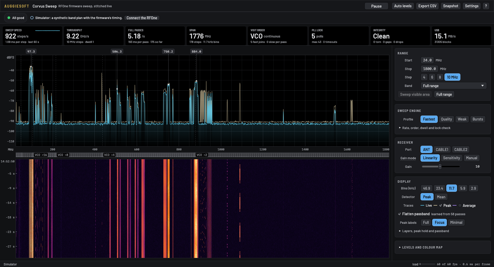

# Corvus

Firmware sweep mode and a live wideband spectrum analyser for the HydraSDR RFOne, the Airspy R2 and
the Airspy Mini, the same analyser for the HackRF One on its stock firmware, and an on-board sweep
program for the PlutoSDR family (Pluto+, ADALM-Pluto).

The board retunes itself and streams only blocks captured after the tuner's PLL has locked, each
tagged with the step it belongs to. On the host, Corvus Sweep stitches those steps into one seamless
spectrum: on the RFOne, **24–1800 MHz about five times a second (8.6 GHz/s), lock-verified, with
12-bit samples.**

| Board | Firmware | Rate | Steps | 24–1800 MHz | Corvus Sweep |
|---|---|---|---|---|---|
| HydraSDR RFOne | `firmware/rfone/`, `v1.0.2-sweep7` | 12 MSPS (or 10) | up to 10 MHz | 8.6 GHz/s, ~5 passes/s | `--board rfone` (default) |
| Airspy R2 | `firmware/airspy/`, `…-sweep7` | 10 MSPS | up to 9 MHz | 6.5 GHz/s, ~3.65 passes/s | `--board airspy` |
| Airspy Mini | the same image as the R2 | 6 MSPS | up to 4 MHz | 2.9 GHz/s, ~1.6 passes/s | `--board mini` |
| HackRF One | **stock** (its own sweep mode, no flashing) | 20 MSPS IQ | 5 MHz slices | 8.1 GHz/s, ~4.6 passes/s (1–6000 MHz: 1.36) | `--board hackrf` |
| Pluto+ / PlutoSDR | its own firmware + `firmware/pluto/` (a program on the board) | 61.44 MSPS IQ (down to 3.84) | up to 50 MHz | ~18–6178 MHz: ~125 GHz/s, ~20 passes/s (Ethernet); a live view | `--pluto HOST` |

The three Corvus boards speak the same sweep protocol, and the same API is added to their host
libraries (libhydrasdr for the RFOne, libairspy for the Airspys). The R2/Mini image detects which board
it's on at boot. The HackRF already has a firmware sweep, so Corvus Sweep drives it as it is, from
1 MHz to 6 GHz. A Pluto runs Linux, so its sweep is a small program on the board (`corvus-pluto`) that
retunes, captures and tags blocks in the same format and serves them over the network: Ethernet on a
Pluto+, or any Pluto's USB network link. In its fast mode it drives the AD936x directly (the chip's
fastlock profiles, switched over SPI in about a microsecond each), about five times the steps of
retuning through the Linux driver, which stays as the fallback.

**Corvus Sweep needs no library or driver install.** It talks to every board over USB itself (a
built-in driver ported from the boards' libraries), so it's one file on Linux and one `.exe` on
Windows, where all four USB boards use WinUSB, which their firmware asks Windows for. The Pluto is
reached over the network.

**Remote: the same window, from anywhere.** One Corvus Sweep shares its radio (`--serve` without a
window, or *Share this radio* in the window); another connects by address and PIN, or finds it on the
LAN, and drives it with the same controls, getting the waterfall history as it connects. The radio
keeps sweeping between visits. See [app/README.md](app/README.md#remote).

**RTL-SDR dongles,** on Windows without Zadig. Plugged in, they show in the radio picker. The first time one is
used, Corvus Sweep downloads librtlsdr (and on Windows a WinUSB driver installer) from the separate
[corvus-rtl](https://github.com/auggiesoft/corvus-rtl) project, checked against hashes built into it. See
[app/README.md](app/README.md#rtl-sdr-dongles).

**Other radios through SoapySDR.** With SoapySDR installed, any IQ radio its modules open (RTL-SDR,
LimeSDR, SDRplay, USRPs such as the B210…) shows in the radio picker and gets the same display, swept from
the PC. Slower than a board's own sweep, but the same waterfall, looks and passband learning. See
[app/README.md](app/README.md#soapysdr-radios).

**Stock firmware works too, just slower.** On an RFOne or Airspy without the Corvus firmware, Corvus
Sweep retunes the board from the PC step by step: about 30–60 steps a second (0.1–0.6 GHz/s), roughly
15–20× slower than the firmware sweep, with the same display and integrity checks.



> **Unofficial.** Corvus is an independent project. It is not affiliated with, endorsed by or
> supported by HydraSDR, Airspy, Great Scott Gadgets or Analog Devices. Product names are used only to say what hardware Corvus works
> with. For official firmware, tools and support, go to the manufacturer.

## What's here

| Directory | |
|---|---|
| [`firmware/`](firmware/) | the Corvus firmware: sweep mode on top of the RFOne firmware v1.0.2 (`rfone/`) and the Airspy R2/Mini firmware (`airspy/`). Protocol, building, flashing, recovery. [`pluto/`](firmware/pluto/): `corvus-pluto`, the sweep program for a Pluto |
| [`host/`](host/) | libhydrasdr (`hydrasdr-host/`) and libairspy (`airspyone-host/`) with the sweep API added (drop-in supersets), builds, on-device tests |
| [`app/`](app/) | **Corvus Sweep**, the spectrum analyser (Rust, egui) |
| [`tools/`](tools/) | `corvus_sweep.py`, a command-line sweep client (rates, integrity, CSV) |
| [`docs/`](docs/) | [measurements](docs/measurements.md): settling, PLL lock, visiting order, 12 MSPS, the Airspy Mini's passband, restarts |

## Try it

Prebuilt firmware images, libraries and Corvus Sweep for Linux and Windows are on the
[Releases](https://github.com/auggiesoft/corvus/releases) page, built by `tools/release.sh` in GitHub
Actions on every version tag. To build everything yourself, run `tools/release.sh` (Docker and Rust).

Corvus Sweep has a simulator that models the firmware's timing, so you can try it with no radio:

```
cd app
cargo run --release -- --sim
```

With a board (everything builds in Docker):

| | RFOne | Airspy R2 or Mini | HackRF One | Pluto+ / PlutoSDR |
|---|---|---|---|---|
| 1. Build the firmware | `firmware/build/build.sh rfone` | `firmware/build/build.sh airspy` | not needed: stock firmware | `firmware/pluto/build.sh` (Rust, no Docker) |
| 2. Flash it (with the board's tools: `host/build/build.sh linux` / `airspy-linux` builds them) | [firmware/README.md](firmware/README.md#flashing) | the same section, with the airspy tools | not needed | install, no flashing: `firmware/pluto/install.sh HOST` ([needs firmware with ADI's capture path](firmware/pluto/README.md)) |
| 3. Run Corvus Sweep (in `app/`) | `cargo run --release` | `cargo run --release` (it finds the R2 or Mini) | `cargo run --release` | `cargo run --release -- --pluto HOST` |

Steps 1–2 are optional for the RFOne and the Airspys: on stock firmware Corvus Sweep falls back to the
slower PC-driven sweep. With more than one board plugged in, pick one with `--board` or `--serial`.

**Back up the board's flash before step 2**, and keep the file. The firmware README has the commands,
and how to recover a board if a flash goes wrong (that means opening the case).

## Status

- The RFOne firmware (`v1.0.2-sweep7`), the library and Corvus Sweep are used daily on one RFOne
  under Linux. Every firmware version has passed the same regression checks: normal streaming is
  unchanged, and the factory calibration survives flashing.
- Corvus Sweep for Windows (`corvus-sweep-<version>-windows-x64.zip` on the Releases page, or
  `app/build/build.sh windows`) is a single `.exe` using the built-in USB driver; first tests on Windows
  hardware are under way. The libhydrasdr Windows build is untested on hardware.
- The Airspy R2 and Mini were added on 2026-11-08 and tested on one board each: firmware flashed from
  stock rc10, calibration intact, normal streaming unchanged with the stock tools, sweeps with clean
  integrity, `host/tests/test_airspy_sweep_api.py` passing, and a killed host never locking out the next
  open. The Mini's main limit is mirror leakage of about −20 dB at its 6 MSPS setting
  ([measurements](docs/measurements.md#airspy-mini)).
- The other R2 hasn't been flashed. Boards on the Corvus firmware still work as normal receivers with
  other software.
- The Pluto was added on 2026-11-11 and tested on one Pluto+ over Gigabit Ethernet (F5OEO's PlutoDVB2
  0.5.16.7 firmware): about 450 steps/s at 40 MHz over 70–6000 MHz, clean integrity, the
  `real_boards` test passing, `corvus-pluto` starting at boot. The board keeps working with other
  software: libiio, SDR apps and its own web pages are untouched while Corvus isn't connected.
  Fast mode followed the same day (~3,300 steps/s), then tuning past the driver's 46.88 MHz–6 GHz (the
  cover reaches ~18–6178 MHz) and the live view. The same board on F5OEO's Tezuka v0.3.24 firmware: fast mode
  at ~2,700 steps/s, with Tezuka's radio pollers paused while Corvus sweeps. RX2 can be selected (switched,
  gain-controlled and back to RX1 cleanly), checked with an antenna on each input in turn.

## Licensing

Corvus's own code is MIT ([`LICENSE`](LICENSE)). That file covers everything in this repository except the
parts below that keep their own licences:

| Part | Licence |
|---|---|
| `firmware/rfone/` | GPL-2.0-or-later (`firmware/rfone/LICENSE`), except the new sweep files `m0/sweep.c` and `m0/sweep.h`, which are MIT; libopencm3 inside it is LGPL-3.0-or-later. The built firmware is GPL-2.0-or-later as a whole |
| `firmware/airspy/` | GPL-2.0-or-later (`firmware/airspy/LICENSE`), except the new sweep files `airspy_m0/sweep.c` and `airspy_m0/sweep.h`, which are MIT; libopencm3 inside it is LGPL-3.0-or-later |
| `host/hydrasdr-host/` | libhydrasdr: MIT, with `hydrasdr.c`/`hydrasdr.h` BSD-3-Clause (`libhydrasdr/LICENSE.md`); tools: GPL-2.0 (`hydrasdr-tools/LICENSE.md`) |
| `host/airspyone-host/` | libairspy: BSD-3-Clause (file headers); tools: see their headers |
| `app/assets/fonts/` | SIL Open Font License 1.1 (`app/assets/fonts/`) |
| everything else (`app/`, `firmware/pluto/`, `tools/`, the build scripts, the docs) | MIT ([`LICENSE`](LICENSE)) |

`firmware/rfone/`, `firmware/airspy/`, `host/hydrasdr-host/` and `host/airspyone-host/` each started as
an unmodified import of the upstream source (see the import commits). The files Corvus changed carry a notice saying so, and `git log` shows every
change.

## Credits

Corvus is built on the RFOne firmware and host library by Benjamin Vernoux, and on the Airspy R2/Mini
firmware and libairspy by Youssef Touil and Benjamin Vernoux. Both descend from the HackRF project
(Jared Boone, Michael Ossmann and others), with contributions from Ian Gilmour and others, and use
libopencm3.
