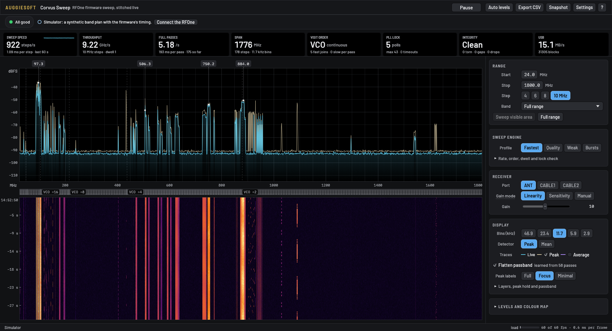

# Corvus Sweep

A live wideband spectrum analyser for an RFOne running the Corvus sweep firmware
(`../firmware/`). The firmware retunes itself and tags each block with its step. Corvus Sweep
writes each step into a stitched spectrum as soon as it arrives. A full 24–1800 MHz pass takes
about 205 ms (8.6 GHz/s).

Rust + egui/eframe (wgpu). It loads libhydrasdr with the Corvus sweep API at run time (built by
`../host/build/build.sh linux`), so a system-wide libhydrasdr stays untouched.



## Run

```
../host/build/build.sh linux            # once: libhydrasdr with the sweep API (needs Docker)
cargo run --release -- --sim            # built-in simulator, no radio needed
cargo run --release                     # the first RFOne found (it must run the Corvus firmware)
cargo run --release -- --serial 0123456789ABCDEF   # a particular board
cargo run --release -- --range 400:470 --order asc
cargo run --release -- --msps 10                 # the older 10 MSPS setting (8 MHz steps)
cargo run --release -- --headless 10 --csv /tmp/spectrum.csv   # no window: rates, seam ripple, CSV
```

Other options: `--lib PATH` (or `CORVUS_LIB`), `--serial HEX` (or `CORVUS_SERIAL`),
`--msps 10|12`, `--step MHZ`, `--bin-khz K`, `--profile NAME`, `--fresh` (ignore saved settings);
`--help` lists them all. Settings persist between runs via eframe storage
(`~/.local/share/corvus-sweep/`). The learned passband correction is stored in
`~/.cache/corvus-sweep/`.

Building needs a Rust toolchain (edition 2024) and, on Linux, the usual Wayland/X11 and Vulkan or
GL libraries that wgpu uses.

## What's on screen

The UI follows the auggiesoft UI guide's Instrument look (`DESIGN.md` has the details and exceptions).

- **Top bar:** Run/Pause, Auto levels, Export CSV, Snapshot, Settings (density, text size, frame
  rate cap, grid and trace brightness) and `?` for the shortcut sheet.
- **Status bar:** one tile ("All good", or how many problems) and the current conditions as
  sentences with a button that fixes each one: RFOne not open, a refused setting, steps lost in the
  last 10 s, lock check off, paused, simulator, a range that can't avoid a VCO switch.
- **HUD:** steps/s (device clock, with a 60 s sparkline), GHz/s, full passes/s, span, visiting
  order, PLL lock polls, integrity (torn / gaps / timeouts / host drops) and USB MB/s. After any
  restart (plan, gain or port change, resume), blocks are dropped quietly until the new run's first
  block arrives, so the old plan's blocks still in flight don't count as misfiled or as gaps.
- **Spectrum:** live trace (cyan), peak hold (sand) and video average (violet) on a black well.
  - Peak labels sit in a rail above the plot with leaders to their peaks. The ones without room go
    into a "+N" list that can centre the view on them.
  - The hover readout is always in the top-left corner.
  - The **sweep beam** faintly lights each step as the firmware visits it, but only when a full pass
    takes about a second or more (fine steps, slow settings). Faster than that it can only flash.
  - Dashed lines mark the tuner's **VCO divider switch points** (50.3, 105.6, 216.3, 437.5, 880 MHz).
- **Sweep strip:** the divider bands, named. When a pass is slow enough to follow, a head and
  flashing cells show the step being measured. In VCO-continuous order the head runs through one
  divider band at a time, every other band backwards, and each pass reverses. Faster sweeps show
  steady cells instead: lit while the step keeps arriving, fading out if it stops.
- **Waterfall:** one row per pass (narrow plans merge passes up to a max row rate), drawn from a GPU
  texture ring. The gutter has relative time, the clock time at the top, and a `retune` line
  wherever gain, port or flattening changed.
  - Changing the range, profile, step, rate, order, dwell, lock reads, settle or bin width doesn't
    clear it. A hard break (a gap with a label such as "400–1000 MHz" or "Quality") marks the
    change, and older rows are re-mapped onto the new frequency axis from their own data: at their
    true frequencies, coarser if they were swept wider, blank where they weren't swept.
- **Footer:** the data source, the frame rate against its cap, and the drawing load.

### Controls

- **Range:** start/stop, step 4/6/8/10 MHz (4/6/8/9 at 10 MSPS), 14 band presets, *Sweep visible
  area*, *Full range*, and a ↶ button back to the previous range.
  - Typed values apply on Enter, Tab or clicking away, and Esc cancels. A typed start above the
    stop, or a stop below the start, keeps the old span.
  - Shift-drag on the plot sweeps the selected range. Ranges smaller than one step become a single
    retuned step.
- **Sweep engine:** a scan profile (F2–F5), with sample rate, order, dwell, lock reads and settle
  under a disclosure. A profile sets those (and the step), and the header then offers a ↶ button
  back to what you had. Range, receiver and display are left alone, except where noted.
  Pass rates are for 24–1800 MHz, measured on the simulator, which models the device's timing:

  | Profile | Step | Dwell | Lock reads | Settle | Also sets | Passes/s |
  |---|---|---|---|---|---|---|
  | Fastest (the default) | 10 MHz | 1 | 2 | 0 | | 5.2 |
  | Quality: flattest part of each step, averaged | 8 MHz | 4 | 3 | 1 | | 1.85 |
  | Weak signals: least noise per bin | 8 MHz | 8 | 2 | 0 | 2.9 kHz bins | 1.3 |
  | Bursts: listens 2/3 of the time, not 1/3 | 10 MHz | 4 | 2 | 0 | peak hold on, cleared | 2.7 |

  All of them use 12 MSPS and VCO-continuous order. A step costs 2 blocks of retune and lock plus
  settle + dwell, so taking lock reads below 2 saves nothing. Turning the lock check off (0) is
  faster, but some steps then read up to 22 dB low (`../docs/measurements.md`). A rate
  change stops streaming, sets the rate and restarts (about 8 ms).
- **Receiver:** RF port, linearity / sensitivity presets or manual LNA/mixer/VGA. Changing these
  stops the sweep, sets the value and restarts (the firmware STALLs tuner requests mid-sweep).
  The bias tee is never touched.
- **Display:** bin width 2.4–39 kHz at 10 MSPS, 2.9–47 kHz at 12 (Welch-averaged below 8192
  points), peak/mean detector, traces, flatten passband, and peak labels Full / Focus / Minimal.
  Beam, switch marks, *Clear peaks* and *Relearn the passband* (a two-step confirm) are under a
  disclosure.
- **Levels** (closed by default): spectrum and waterfall ranges, Inferno / Viridis / Grey colour
  maps, history length and row rate.
- **Sliders** never jump. Drag relative to the current value (Shift for fine), use the wheel, or
  double-click to type. Double-click the label to reset. A changed value leaves a dashed ghost and
  a ↶ button back to it.
- **Labels with a dotted underline** explain themselves on hover; click to keep the explanation
  open.
- **Mouse and keys:**
  - Scroll zooms, drag pans, double-click resets the view.
  - Drag or scroll the dB gutter to move or stretch the scale.
  - **?** or **F1** shows every shortcut. The main ones:
    - Sweep: Space run/pause, **G** type a range (Start, Tab, Stop, Enter), **1–9** band presets,
      F full range, Backspace previous range, Shift ←/→ move the range by its own width,
      S sweep the visible area, [ / ] step size, M 10/12 MSPS, O visiting order.
    - Profiles: F2 Fastest, F3 Quality, F4 Weak signals, F5 Bursts.
    - View: ←/→ pan, + / − zoom, 0 or Home reset zoom, ↑/↓ move the dB scale.
    - Display: A auto levels, P clear peak, H peak hold, V average, E flatten passband, B beam.
    - Files: Ctrl+E export CSV, Ctrl+S snapshot.
  - Keys are ignored while a text field has the cursor.
- *Export CSV* and *Snapshot* write to `../captures/` if it exists (gitignored), otherwise to
  `~/.local/share/corvus-sweep/captures/`.

## Seamless stitching

- Each step contributes exactly the bins in [−step/2, +step/2) around its centre. The raw spectrum is
  inverted: RF = centre − (f_IF − IF), with the IF at a quarter of the ADC rate (5 or 6 MHz). Steps tile
  the range with no overlap and no gap.
- The step widths come from the measured passband (`../docs/measurements.md`). At 10 MSPS it
  is flat to ±1 dB over −4.70…+4.20 MHz, so steps go up to 9.3 MHz (8 by default). At 12 MSPS the tuner
  filter is wide open: ±1 dB over −4.85…+5.15 MHz, so steps go up to 10 MHz.
- The remaining seam is the per-step passband ripple: the edges sit 1.6–2.5 dB high and there is a
  small spur at fs/4. *Flatten passband* learns that shape as follows:
  - per bin, the median across all steps of each step's level relative to its own median, averaged over passes;
  - signals sit at different offsets in different steps, so the median rejects them;
  - it learns on any plan with ≥ 12 steps, is stored per sample rate and bin width, and is reused for narrow plans.
- Measured on the RFOne (full range, smoothed over 1 % of a step): **2.2–2.5 → 0.27–0.32 dB p-p** at 12 MSPS
  with 10 MHz steps, and **1.6 → 0.27 dB p-p** at 10 MSPS with 8 MHz steps. `--headless` prints this figure.

## Measured (2026-11-05, ANT, linearity 10, 24–1800 MHz, dwell 1, lock reads 2)

| Firmware | Rate, step | Order | Steps/s | GHz/s | Passes/s | Torn / gaps / misfiled |
|---|---|---|---|---|---|---|
| sweep4 | 10 MSPS, 8 MHz | VCO-continuous | 780–823 | 6.2–6.6 | 3.5–3.7 | 0 / 0 / 0 |
| sweep5 | 10 MSPS, 8 MHz | VCO-continuous | 790–840 | 6.3–6.7 | 3.6–3.8 | 0 / 0 / 0 |
| sweep5 | 12 MSPS, 10 MHz | VCO-continuous | 835–895 | 8.4–9.0 | 4.7–5.0 | 0 / 0 / 0 |
| simulator | 10 MSPS, 8 MHz | VCO / ascending | ~785 / ~671 | | | |

Each step takes exactly 3 blocks at either rate (1 measured, 2 for retune, lock and waiting for a fresh
block). 12 MSPS blocks are 341 µs instead of 410 µs, which is where the extra steps/s come from.

FM broadcast (87.5–108, 3 steps at 10 MSPS) runs at ~85 passes/s. It straddles the 105.6 MHz switch (104.6 at 12 MSPS), which
costs one ~10 ms crossing per pass in either order, and the status bar says so. The release build draws
at 60 fps by default; Settings caps it at 30, 20 or 15 to save power.

## Robustness

- Every block is checked: magic, header == trailer, freq == f0 + step·f_step, lock timeout. A
  `(sweep, step)` model of the firmware's visiting order counts gaps.
- SIGINT/SIGTERM/SIGHUP close the device cleanly. If the window can't close within 1.5 s, a signal
  path calls `sweep_stop` + `stop_rx` itself.
- Under RAW, libhydrasdr reads a sample rate given by value as the real ADC rate, so the device code asks
  for 20 or 24 MSPS. Asking for 12000000 under RAW quietly selects the 6 MSPS IQ setting (12 MSPS real).
- A host killed mid-sweep used to strand the board: every later open failed with LIBUSB −1000.
  It was found while building this tool and fixed on 2026-11-05 in the library (open sends SWEEP_STOP
  first) and in firmware sweep5 (SET_PACKING ends a sweep). Tested: SIGKILL of a sweeping GUI, then reopen, works.

## Layout

| File | |
|---|---|
| `src/hydra.rs` | libloading FFI to libhydrasdr, block tags, `Device` (open, configure, sweep, stop → set → start) |
| `src/plan.rs` | sample rate, range → step grid, firmware visiting order, VCO divider model, presets |
| `src/dsp.rs` | raw block → dBFS power on the RF offset grid (rustfft, Hann, Welch) |
| `src/engine.rs` | worker thread: parse, accumulate dwell, stitch, peak/avg, flatness learner, waterfall rows, stats |
| `src/sim.rs` | synthetic band plan with the firmware's hop timing |
| `src/app.rs`, `waterfall.rs` | UI: frame, status, HUD, sidebar, plot, waterfall, keys |
| `src/theme.rs` | Instrument tokens, house fonts, and the guide's widgets (never-jumping slider, hints, two-step confirm) |
| `assets/fonts/` | Barlow, Barlow Semi Condensed, Auggie Mono (SIL OFL), compiled in |
| `DESIGN.md` | how the UI follows the auggiesoft guide, and its exceptions |

`cargo test` runs offline checks: tag parsing, tone placement and level at every FFT size and both rates,
plan geometry, divider switch points (and their 1 MHz shift at 12 MSPS) and transitions, and the worker's
stitching and pass counting.

## Known gaps

- *Snapshot* uses eframe's wgpu screen capture. It never returned on a Hyprland headless output and
  is untested on a real display (`grim` works as a fallback).
- Linux only for now. `../host/build/build.sh windows` builds the library for Windows, but the app
  hasn't been built or tested there.
